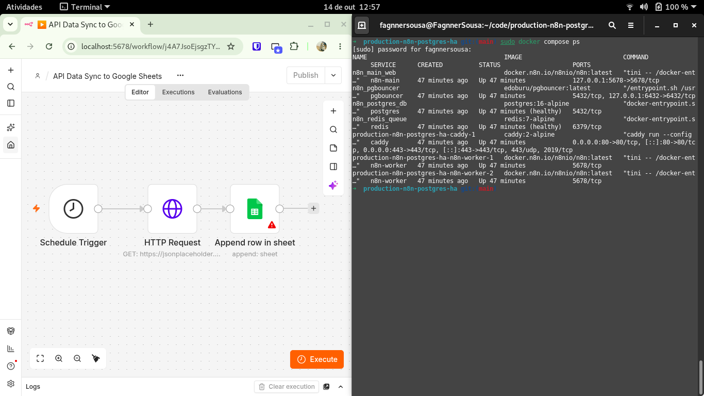

# Fault-Tolerant n8n & PostgreSQL Production Stack (Docker Compose)



Reference production architecture designed to eliminate the 3 most common failure modes in self-hosted automation and webhook infrastructures:

1. **Node.js Out-Of-Memory (OOM) Crashes on Webhook Spikes:** Solved by decoupling the main webhook receiver (`n8n-main`) from execution processing using **Redis Queue Mode** (`EXECUTIONS_MODE=queue`) and dedicated horizontal worker replicas (`n8n-worker`) with explicit V8 heap ceilings (`--max-old-space-size=1536`).
2. **PostgreSQL Connection Exhaustion & High CPU:** Solved by routing traffic through **PgBouncer** (`MAX_CLIENT_CONN=1000` -> `DEFAULT_POOL_SIZE=40`) alongside tuned PostgreSQL memory allocation and automatic slow-query logging (`log_min_duration_statement=500ms`).
3. **Silent Webhook Timeouts:** Handled via **Caddy** reverse proxy and isolated Redis persistence (`--appendonly yes`, `noeviction` policy) so burst traffic is buffered safely in memory before execution.

## Quick Start (Staging / Production)

```bash
cp .env.example .env
docker compose up -d
docker compose ps